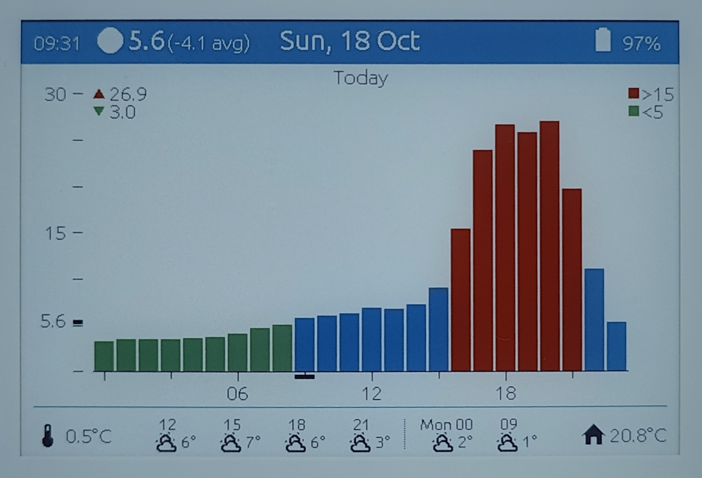
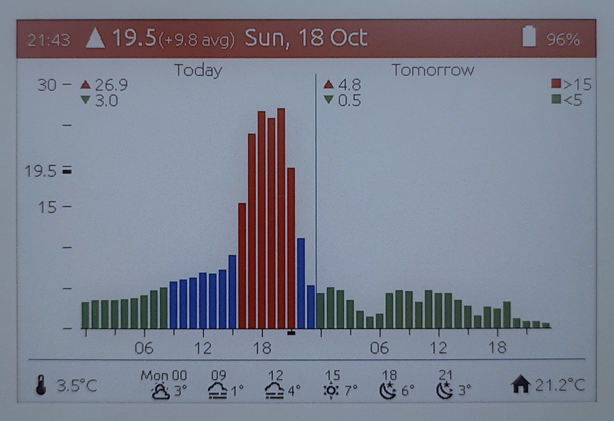
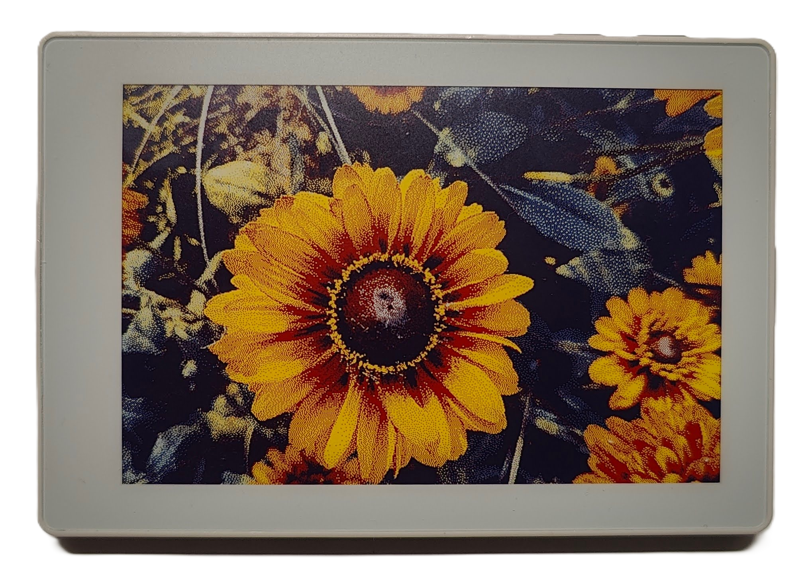

# ESPHome M5Stack PaperColor Dashboard

A custom Home Assistant (HA) dashboard for [M5Stack PaperColor](https://docs.m5stack.com/en/core/PaperColor).

### Dashboard Display

- Nord Pool hourly prices today & tomorrow
- Weather forecast from HA weather integration
- Current Outdoor temperature from HA sensor
- Indoor temperature from the onboard sensor
- Optional [picture frame](#picture-frame) mode showing a full-screen photo fetched over HTTP

<picture>
  
</picture>
<picture>
  
</picture>

### Picture Frame as an alternative display mode

The panel can also work as a digital **picture frame**, displaying a full-screen photo downloaded over HTTP instead of the dashboard (ESPHome `online_image` component).

<picture>
  
</picture>

NOTE: displaying a normal image as such results in poor image quality on the display.
Better results can be achieved by calibrating the image to suit the Spectra 6 palette.

* **Online Image URL** text box — holds the picture's URL and is restored across reboots. Changing it applies immediately: the new URL is set on the image component with an update, so the fresh picture is fetched right away.
* **Online Image: Show image** switch — toggles between the regular dashboard and the full-screen picture view.
  * Turning ON only downloads if no ready frame is already in memory; otherwise the cached picture is simply redrawn. The wait is bounded (~20 s) — on timeout or failure the normal dashboard is shown instead, never garbage pixels.
  * Turning OFF just redraws the dashboard.
  * Its state survives PMIC cold boots; at boot, if left ON, a fresh copy of the picture is pulled before the first refresh.
* **Button B** toggles picture frame mode from hardware (same behavior as flipping the HA switch).
* **Button A** keeps its normal display-refresh role, but while picture frame mode is active it forces a re-fetch first, so you always see the latest version rather than the previously downloaded one.

### Voice assistant
The device has integration to HA's assistant using ESPHome `voice_assistant` component, wired to the onboard microphone and speaker.

- **Button B** toggles [picture frame](#picture-frame) mode (dashboard ↔ full-screen picture).
- **Button C** starts a voice assistant session. Press the button to begin listening, then speak; silence detection ends the session automatically when you stop talking.
- **LED feedback** during a session:
  - Red — microphone is listening
  - Blinking yellow — speech is being processed (STT / intent)
  - Yellow — TTS response is playing
  - Restored to the normal indicator state (or orange when low battery is active) when the session ends or errors
- **Volume** is controlled from HA via the *TTS Audio DAC Volume* and *TTS Speaker Volume* numbers (0–100%, applied when TTS playback starts).

## HA integration details

Exported sensors

### Sensors (read-only)
* Room Temperature
* Room Humidity
* Battery Voltage (mV)
* Battery (%)
* WiFi Signal dB
* WiFi Signal Percent
* USB Connected
* Uptime
* Build DateTime
* IP Address
* Connected SSID
* Last Reset Reason
* Button A
* Button C

Controllable variables

### Text boxes (controllable from HA)
* **Online Image URL** — HTTP(S) URL of the picture used in [picture frame](#picture-frame) mode; restored across reboots, applying a new value triggers an immediate fetch

### Numbers (controllable from HA)
* **On USB Refresh Interval** — 5–120 min, step 5
* **Indicator LED Brightness** — 1–100%, step 1
* **On Battery Sleep Duration** — 5–120 min, step 5
* **Overnight Begin Hour** — 0–23
* **Overnight End Hour** — 0–23
* **Threshold Static Low** — 0–15 c/kWh, step 1
* **Threshold Static High** — 15–50 c/kWh, step 1
* **Threshold Pct Low** — 0.05–0.50, step 0.05
* **Threshold Pct High** — 0.50–0.95, step 0.05
* **Max scale standard** — 0–50 c/kWh, step 5
* **TTS Audio DAC Volume** — 0–100%, step 1 (volume applied to the audio DAC when TTS playback starts)
* **TTS Speaker Volume** — 0–100%, step 1 (volume applied to the speaker when TTS playback starts)

## Switches (controllable from HA)
* **Simulate Low Battery** — test low-battery screen
* **Overnight Quiet Mode** — skip display refresh during configured overnight hours
* **Show Legend** — show/hide chart legend
* **Threshold Dynamic** — enable percentage-based thresholds
* **Powered Indicator LED** — enable/disable powered-on indicator
* **Online Image: Show image** — toggle between dashboard and full-screen picture view ([picture frame](#picture-frame))

Imported from HA

### Imported from Home Assistant (read-only inputs)
* **ha_outdoor_temp** — outdoor temperature
* **nordpool_prices_csv** — today's Nord Pool prices
* **nordpool_tomorrow_csv** — tomorrow's Nord Pool prices
* **ha_time** — Home Assistant time

## Credits and Attribution

This project is based on [ESPHome-m5stackPaperColor](https://github.com/h0verin/ESPHome-m5stackPaperColor) by [h0verin](https://github.com/h0verin).

The original project is licensed under the MIT License. The original copyright and license notices are preserved in the `LICENSE` file.

Modifications to the original project, including display layout changes and other improvements, are maintained by [rkelkka](https://github.com/rkelkka).

## License

See [LICENSE](LICENSE) for the applicable license terms.
