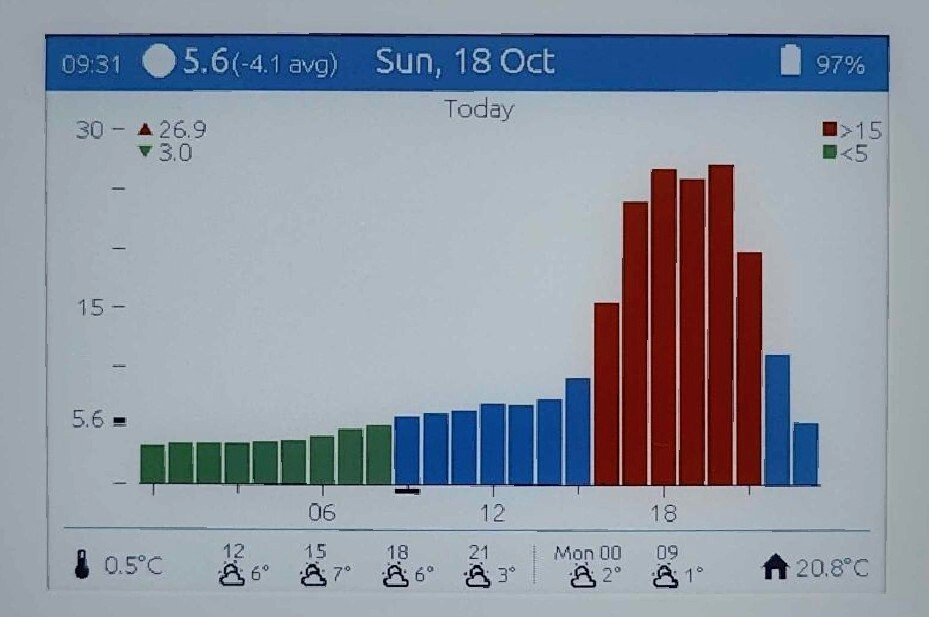
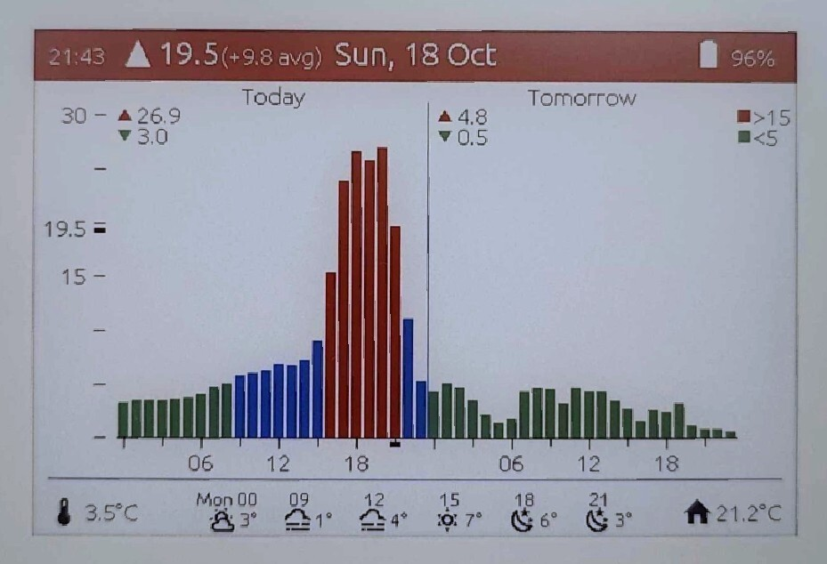

# ESPHome M5Stack PaperColor Dashboard

A custom Home Assistant (HA) dashboard for [M5Stack PaperColor](https://docs.m5stack.com/en/core/PaperColor).

Currently displaying Nord Pool hourly prices, weather forecast from HA weather integration, outdoor temperature from HA sensor and indoor temperature from onboard sensor.

## HA integration details

Exported sensors

### Sensors (read-only)
* Room Temperature
* Room Humidity
* Battery Voltage (mV)
* Battery (%)
* WiFi Signal dB
* WiFi Signal Percent
* USB Connected
* Uptime
* Build DateTime
* IP Address
* Connected SSID
* Last Reset Reason
* Button A
* Button C

Controllable variables

### Numbers (controllable from HA)
* **On USB Refresh Interval** — 5–120 min, step 5
* **Indicator LED Brightness** — 1–100%, step 1
* **On Battery Sleep Duration** — 5–120 min, step 5
* **Overnight Begin Hour** — 0–23
* **Overnight End Hour** — 0–23
* **Threshold Static Low** — 0–15 c/kWh, step 1
* **Threshold Static High** — 15–50 c/kWh, step 1
* **Threshold Pct Low** — 0.05–0.50, step 0.05
* **Threshold Pct High** — 0.50–0.95, step 0.05
* **Max scale standard** — 0–50 c/kWh, step 5

## Switches (controllable from HA)
* **Simulate Low Battery** — test low-battery screen
* **Overnight Quiet Mode** — skip display refresh during configured overnight hours
* **Show Legend** — show/hide chart legend
* **Threshold Dynamic** — enable percentage-based thresholds
* **Powered Indicator LED** — enable/disable powered-on indicator

Imported from HA

### Imported from Home Assistant (read-only inputs)
* **ha_outdoor_temp** — outdoor temperature
* **nordpool_prices_csv** — today's Nord Pool prices
* **nordpool_tomorrow_csv** — tomorrow's Nord Pool prices
* **ha_time** — Home Assistant time

## Credits and Attribution

This project is based on [ESPHome-m5stackPaperColor](https://github.com/h0verin/ESPHome-m5stackPaperColor) by [h0verin](https://github.com/h0verin).

The original project is licensed under the MIT License. The original copyright and license notices are preserved in the `LICENSE` file.

Modifications to the original project, including display layout changes and other improvements, are maintained by [rkelkka](https://github.com/rkelkka).

## License

See [LICENSE](LICENSE) for the applicable license terms.
